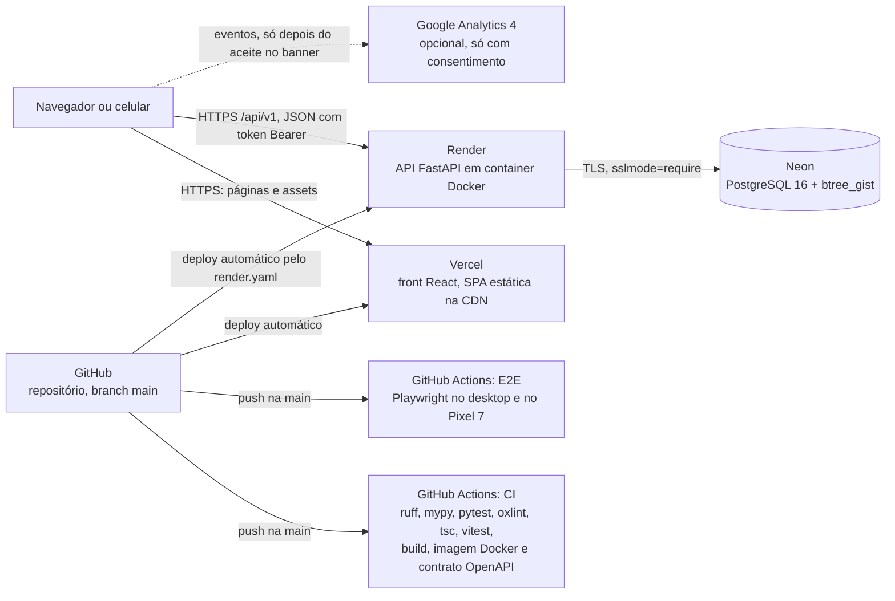
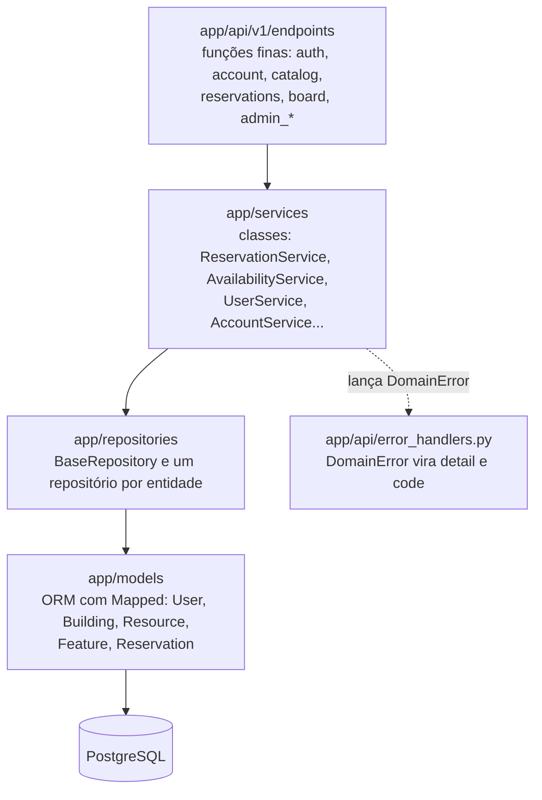
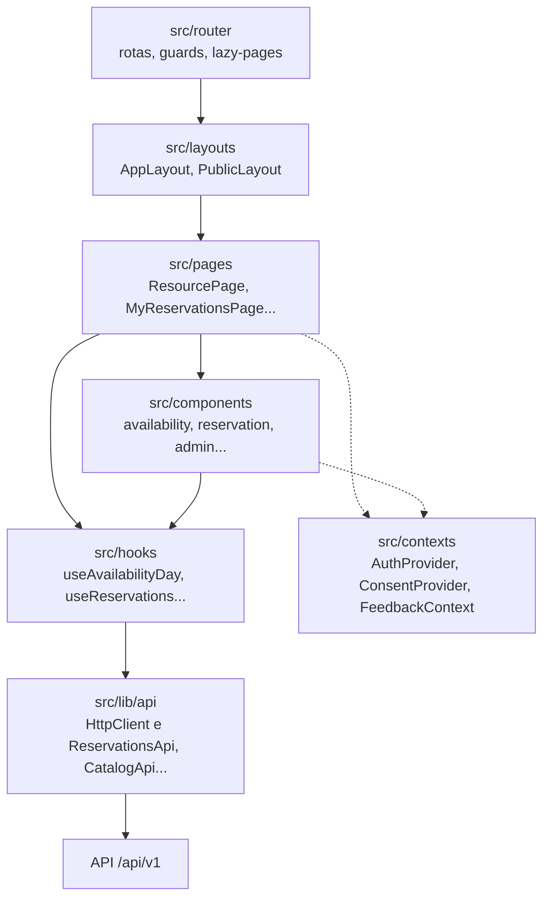
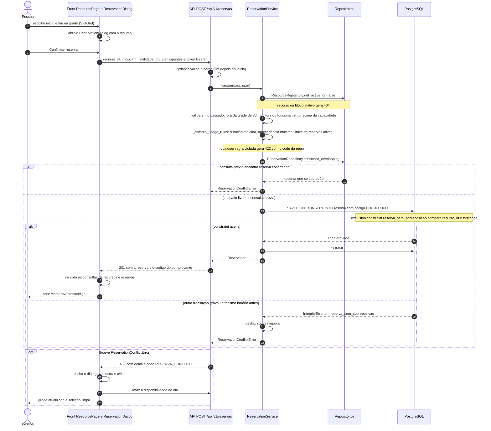

# Arquitetura do EduSpace

Issue #37. Visão geral de como as peças do EduSpace se ligam, como uma reserva passa por elas e
por que a regra "nunca duas reservas no mesmo espaço e horário" (RNF03) fica no banco.

As decisões de stack e convenções estão no [ADR 0001](adr/0001-arquitetura-e-stack.md). Este
documento descreve o sistema como ele está implementado.

## Componentes



| Peça | Onde roda | O que faz |
|---|---|---|
| Front | Vercel | SPA React 19 + Vite. As páginas públicas têm o `<head>` pré-renderizado (SEO, #48). O `vercel.json` faz o rewrite da SPA e define cache e cabeçalhos de segurança |
| API | Render, container Docker (`backend/Dockerfile`) | FastAPI. Na subida, `scripts/start.sh` aplica as migrações (`alembic upgrade head`), roda o seed opcional e inicia o `uvicorn` com `--proxy-headers` |
| Banco | Neon | PostgreSQL 16 com a extensão `btree_gist`, criada pela primeira migração |
| CI | GitHub Actions, `.github/workflows/ci.yml` | A cada push na `main`: gate do back (`make ci`) contra um Postgres de serviço, gate do front (`npm run ci`), build da imagem Docker e verificação de que `schema.d.ts` bate com o OpenAPI da API |
| E2E | GitHub Actions, `.github/workflows/e2e.yml` | A cada push na `main` que mexe no back ou no front: Playwright com banco próprio, fluxo principal, auditoria de acessibilidade e responsividade |
| Analytics | Google Analytics 4 | Só carrega se `VITE_GA_MEASUREMENT_ID` estiver definido e a pessoa aceitar no banner de cookies (Consent Mode, #49). Sem aceite, nenhum script do Google é baixado |

O deploy não passa pelo GitHub Actions: a Vercel e o Render observam a `main` e publicam sozinhos.
O passo a passo e as variáveis de ambiente estão em [deploy.md](deploy.md). O front pode
chamar a API direto no domínio do Render (com CORS) ou pelo mesmo domínio, com um rewrite
`/api/*` da Vercel, descrito no fim do guia de deploy.

## Camadas do backend

Fluxo de dependência: **endpoint → service → repository → model**. Cada camada só conhece a de
baixo. As dependências entram pelo construtor e chegam aos endpoints por `Depends`, montadas em
`app/api/dependencies.py`.



| Pasta | Conteúdo |
|---|---|
| `app/api/v1/endpoints/` | Um módulo por área (`auth.py`, `account.py`, `catalog.py`, `reservations.py`, `board.py`, `config.py`, `health.py`, `admin_buildings.py`, `admin_resources.py`, `admin_features.py`, `admin_users.py`, `admin_reservations.py`). Só leem a entrada, pegam o usuário atual e chamam o service. Declaram `response_model` e `responses` para o OpenAPI |
| `app/api/dependencies.py` | Providers de sessão, relógio, regras, repositórios e services. É aqui que cada service recebe o que precisa |
| `app/api/error_handlers.py` | Converte qualquer `DomainError` em `{ "detail", "code" }` com o status da classe |
| `app/services/` | Regras de negócio em classes, uma por arquivo. Nunca lançam `HTTPException` |
| `app/repositories/` | `BaseRepository[ModelT]` (`base.py`) com `get`, `add` e `paginate`, e um repositório por entidade. `overlap.py` guarda o predicado de sobreposição usado pela busca, pela grade e pelo quadro |
| `app/models/` | Entidades ORM. Tabelas e colunas em pt-BR, classes em inglês |
| `app/schemas/` | DTOs Pydantic de entrada e saída e o envelope `Page[T]` |
| `app/core/` | Configuração, enums, hierarquia de exceções, `Clock`, horário de funcionamento (`campus_schedule.py`), regras de uso (`reservation_rules.py`), códigos de comprovante, segurança e rate limit |
| `app/db/` | Base declarativa, mixins, sessão e `UnitOfWork` (commit e savepoint) |

## Camadas do frontend

Fluxo: **page → layout → component**, com os dados vindo de **hooks do TanStack Query** que usam
as **classes de `src/lib/api/`**.



| Pasta | Conteúdo |
|---|---|
| `src/router/` | `routes.tsx` liga cada rota ao layout; `guards.tsx` protege as rotas privadas e as de admin; `lazy-pages.ts` carrega cada página sob demanda; `paths.ts` centraliza as URLs |
| `src/layouts/` | `AppLayout` (área logada, navegação lateral no desktop e inferior no celular) e `PublicLayout` (landing, sobre, ajuda, termos) |
| `src/pages/` | Uma página por rota, com default export. Orquestram dados e estado da tela |
| `src/components/` | Componentes por domínio: `availability/` (grade), `reservation/` (diálogos de reserva e cancelamento), `admin/`, `catalog/`, `legal/`, `form/` |
| `src/hooks/` | Hooks do TanStack Query por domínio. As consultas que mudam com reservas de outras pessoas usam `liveQueryOptions` (`src/lib/live-query.ts`), refeitas a cada 10 s com a aba visível |
| `src/lib/api/` | `HttpClient` (fetch, token, timeout, conversão de erro em `ApiError`) e uma classe por domínio (`ReservationsApi`, `CatalogApi`, `AuthApi`, `BoardApi`, `AdminCatalogApi`...). `schema.d.ts` é gerado do OpenAPI e não se edita à mão |
| `src/contexts/` | Sessão (`AuthProvider`), consentimento de cookies (`ConsentProvider`) e avisos (`FeedbackContext`) |
| `src/domain/` | Regras puras de apresentação: seleção de horários na grade, rótulos, fuso do campus |
| `src/schemas/forms/` | Schemas zod dos formulários, com tipos inferidos |

Diálogos de formulário e de confirmação, como o `ReservationDialog`, executam a própria mutação.
Mesmo assim, toda chamada HTTP passa por uma classe de `src/lib/api/`.

## Fluxo de uma reserva

A pessoa abre um recurso (`/recursos/:id`), escolhe início e fim na grade, confere o resumo e
confirma. A ordem das validações abaixo é a de `ReservationService.create`
([reservation_service.py](../backend/app/services/reservation_service.py)).



Detalhes que o diagrama não mostra:

- Se o código sorteado já existir (`uq_reserva_codigo`), o service sorteia outro, até 5 vezes.
  O savepoint deixa a sessão utilizável depois de cada tentativa.
- No front, uma trava síncrona no `ReservationDialog` impede que dois cliques seguidos enviem duas
  requisições. As regras de duração, antecedência e limite também são conferidas antes de chamar a
  API (#28), mas quem decide é o back.
- O 409 traz a mensagem pronta: "Este horário acabou de ser reservado por outra pessoa. Escolha
  outro horário na grade." O `ReservationDialog` fecha, mostra o aviso, invalida as consultas de
  recursos e chama `onConflict`, que limpa a seleção na `ResourcePage`.
- O comprovante (`/comprovantes/:codigo`) é público e mostra só o primeiro nome de quem reservou.

## Decisão: exclusion constraint para o RNF03

### O que está no banco

Criada na migração
[`8e84561afa7a_create_reserva`](../backend/alembic/versions/20261013_8e84561afa7a_create_reserva.py)
e declarada no model [`Reservation`](../backend/app/models/reservation.py):

```sql
CREATE EXTENSION IF NOT EXISTS btree_gist;  -- migração 8f75fac99981, a primeira

ALTER TABLE reserva ADD CONSTRAINT reserva_sem_sobreposicao
  EXCLUDE USING gist (recurso_id WITH =, tstzrange(inicio, fim, '[)') WITH &&)
  WHERE (status = 'CONFIRMADA');
```

Leitura: não podem existir duas linhas com o mesmo `recurso_id` (`=`) cujos intervalos se
sobreponham (`&&`), considerando só as reservas confirmadas.

- **`tstzrange(inicio, fim, '[)')`**: o intervalo inclui o início e exclui o fim. Assim
  19:00 às 20:00 e 20:00 às 21:00 convivem, e 19:00 às 20:00 contra 19:30 às 20:30 é recusado.
- **`WHERE (status = 'CONFIRMADA')`**: reserva cancelada sai da regra e o horário volta a ficar
  livre (História 03, CA2), sem apagar nada.
- **`btree_gist`**: o índice GiST sabe comparar intervalos, mas não sabe comparar `bigint` com
  `=`. A extensão dá ao GiST esse operador, e a constraint consegue combinar as duas colunas.
- O mesmo índice GiST atende as consultas de sobreposição da busca, da grade e do quadro, porque
  `overlap.py` usa o mesmo predicado ([performance.md](qualidade/performance.md)).

### Por que só o código não basta

A verificação no código é "consultar, depois gravar". Entre as duas etapas existe uma janela:

1. A requisição A consulta: o horário está livre.
2. A requisição B consulta no mesmo instante: o horário ainda está livre, porque A não gravou.
3. A grava. B grava. As duas recebem 201 e o espaço fica com duas reservas.

Isso é uma condição de corrida. Nenhum `if` no Python fecha essa janela, porque cada requisição
roda na sua conexão e não enxerga o que a outra ainda não confirmou. Em produção ela aparece no
pior momento: a abertura das reservas de um horário disputado.

Com a constraint, o banco confere a regra no próprio `INSERT`. Quando B tenta gravar um intervalo
que conflita com uma linha de A ainda não confirmada, o PostgreSQL faz B esperar a transação de A
terminar. Se A confirmou, o `INSERT` de B falha com violação de exclusão. Se A desfez, B grava
normalmente. Não há caminho em que as duas gravem.

O service trata a falha assim:

- grava dentro de um savepoint (`UnitOfWork.savepoint`), para a falha desfazer só a tentativa;
- lê o nome da constraint violada no erro do driver;
- se for `reserva_sem_sobreposicao`, lança `ReservationConflictError`, que o handler global
  transforma em `409 RESERVA_CONFLITO`.

A consulta prévia (`confirmed_overlapping`) continua no service porque resolve o caso comum mais
cedo, com a mesma mensagem. A garantia é a constraint.

### Como isso é provado

| Teste | O que prova |
|---|---|
| [`backend/tests/test_reservation_concurrency.py`](../backend/tests/test_reservation_concurrency.py), `test_two_simultaneous_requests_give_one_reservation_and_one_conflict` | Duas threads, cada uma com sua conexão e sua transação com commit, esperam numa barreira e chamam `ReservationService.create` para o mesmo recurso e horário ao mesmo tempo. O resultado é exatamente um 201 e um 409 |
| [`backend/tests/services/test_reservation_service.py`](../backend/tests/services/test_reservation_service.py), `test_the_database_constraint_wins_a_race` | Desliga a consulta prévia para simular a corrida. A constraint recusa, o service devolve conflito e a sessão continua utilizável |
| [`backend/tests/models/test_reservation_constraints.py`](../backend/tests/models/test_reservation_constraints.py) | A constraint sozinha: recusa sobreposição, aceita reservas encostadas, ignora canceladas e recusa intervalo invertido |
| [`backend/tests/test_migrations.py`](../backend/tests/test_migrations.py), `test_head_enables_btree_gist` | A extensão existe depois das migrações |
| [`frontend/e2e/reservation.e2e.ts`](../frontend/e2e/reservation.e2e.ts), "avisa quando o horário é tomado antes da confirmação e atualiza a grade" | O caminho completo no navegador: outra pessoa reserva enquanto o resumo está aberto, a confirmação recebe 409 e a grade é atualizada |

Os testes do back rodam contra PostgreSQL real, nunca SQLite, que não tem exclusion constraint.

### Alternativas descartadas

| Alternativa | Por que não |
|---|---|
| Só verificar no código | Condição de corrida descrita acima |
| `UNIQUE (recurso_id, inicio)` | Pega só reservas com o mesmo início. 19:00 às 20:00 contra 19:30 às 20:30 passaria |
| `SELECT ... FOR UPDATE` no recurso antes de gravar | Funciona enquanto todo caminho de escrita lembrar de travar. Seed, admin e scripts futuros poderiam esquecer. A constraint vale para qualquer escrita |
| Isolamento `SERIALIZABLE` | Exige repetir a transação em toda falha de serialização e afeta todas as consultas, não só a reserva |

## Documentos relacionados

- [ADR 0001: arquitetura, stack e convenções](adr/0001-arquitetura-e-stack.md)
- [ADR 0002: exclusão de blocos e recursos pela administração](adr/0002-exclusao-de-blocos-e-recursos.md)
- [Modelo de dados (DER e dicionário)](modelagem/der.md)
- [Deploy: Neon, Render e Vercel](deploy.md)
- [Rastreabilidade de requisitos](rastreabilidade.md)
- [Performance: RNF02](qualidade/performance.md)
- [Responsividade e acessibilidade: RNF01](qualidade/acessibilidade-e-responsividade.md)
- [SEO das páginas públicas](qualidade/seo.md)
- [Revisão LGPD dos endpoints](lgpd/revisao-endpoints.md)
- [Design system](design/design-system.md)
