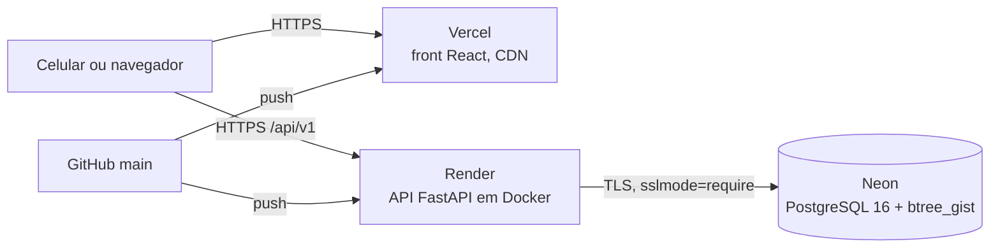

# Deploy: Neon, Render e Vercel

Issue #19. O que está versionado no repositório e o passo a passo para colocar o EduSpace no ar.
Nenhum segredo fica no Git: todos entram pelos painéis dos provedores.



## O que já está pronto

| Peça | Arquivo | O que faz |
|---|---|---|
| Imagem da API | [`backend/Dockerfile`](../backend/Dockerfile) | Python 3.13, dependências pelo `uv.lock`, roda como usuário sem privilégios. O CI constrói a imagem a cada mudança no back |
| Inicialização | [`backend/scripts/start.sh`](../backend/scripts/start.sh) | `alembic upgrade head`, seed opcional (`SEED_ON_START`) e `uvicorn` com `--proxy-headers`, para o limite de tentativas de login enxergar o IP real atrás do proxy do Render |
| Serviço no Render | [`render.yaml`](../render.yaml) | Blueprint: Docker, região Virgínia, health check em `/api/v1/health`, deploy automático a cada push na `main`, `JWT_SECRET` gerado pelo próprio Render |
| Front na Vercel | [`frontend/vercel.json`](../frontend/vercel.json) | Build do Vite, rewrite da SPA (refresh em `/minhas-reservas` não dá 404), cache longo dos assets e cabeçalhos de segurança |
| URL do Neon | `DATABASE_URL` | Pode ser colada como o Neon entrega (`postgresql://...`): a API troca pelo driver `psycopg` sozinha |

A extensão `btree_gist`, exigida pela regra que impede reservas sobrepostas, é criada pela
primeira migração. O usuário dono do banco no Neon tem permissão para isso.

## Passo a passo

### 1. Banco no Neon

1. Crie o projeto no Neon (plano gratuito), região **AWS US East (N. Virginia)**, Postgres 16.
2. Copie a connection string do banco (`postgresql://...neon.tech/...?sslmode=require`).

### 2. API no Render

1. No Render: **New > Blueprint**, escolha este repositório. O `render.yaml` cria o serviço
   `eduspace-api`.
2. Preencha os segredos pedidos:

| Variável | Valor |
|---|---|
| `DATABASE_URL` | A connection string do Neon |
| `CORS_ORIGINS` | A URL da Vercel, sem barra no fim (ex.: `https://eduspace.vercel.app`) |
| `SEED_ADMIN_EMAIL` | E-mail institucional do administrador inicial |
| `SEED_ADMIN_SENHA` | Senha forte, com letras e números |

3. Aguarde o deploy e abra `https://<api>.onrender.com/api/v1/health`: deve responder
   `{"status":"ok","db":"ok"}`. O Swagger fica em `/docs`.

O plano gratuito do Render dorme depois de 15 minutos sem uso, e a primeira requisição leva cerca
de 50 segundos. Antes da apresentação, abra o health check uns minutos antes (#38).

### 3. Front na Vercel

1. Na Vercel: **Add New > Project**, este repositório, **Root Directory** `frontend`. O framework
   e o build vêm do `vercel.json`.
2. Variáveis de ambiente (Production):

| Variável | Valor |
|---|---|
| `VITE_API_URL` | `https://<api>.onrender.com/api/v1` |
| `VITE_SITE_URL` | A URL pública da Vercel, sem barra no fim |
| `VITE_GA_MEASUREMENT_ID` | ID da propriedade GA4 (#49); vazio desliga o Analytics |
| `VITE_SUPPORT_EMAIL` | E-mail do suporte mostrado na Ajuda (#47); vazio orienta procurar a administração |

3. Depois do primeiro deploy, confirme que `CORS_ORIGINS` no Render é exatamente a URL da Vercel.

## Verificação depois do deploy

- [ ] Abrir o site no celular, criar conta com e-mail `@umj.edu.br` e entrar.
- [ ] Reservar um horário, ver o comprovante e cancelar.
- [ ] Recarregar a página em `/minhas-reservas`: não pode dar 404.
- [ ] Push na `main` atualiza front e API sem passo manual.
- [ ] `/robots.txt` e `/sitemap.xml` acessíveis; link compartilhado no WhatsApp mostra título,
  descrição e imagem (#48).
- [ ] Registrar as URLs no README.

## Melhoria medida e opcional: API na mesma origem

Na #32, servir a API pelo mesmo domínio do front (um rewrite `/api/:path*` da Vercel para o
Render) eliminou o preflight de CORS de cada chamada e rendeu de 4 a 7 pontos de Performance no
Lighthouse mobile. Para usar, acrescente ao `vercel.json`, antes do rewrite da SPA:

```json
{ "source": "/api/:path*", "destination": "https://<api>.onrender.com/api/:path*" }
```

e troque `VITE_API_URL` para `/api/v1`. O CORS deixa de ser necessário para o próprio site.
