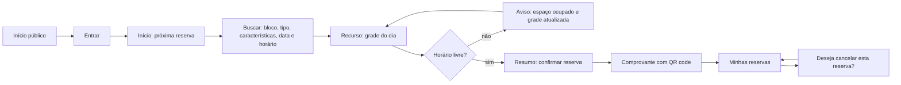

# Wireframes e protótipo do EduSpace

Entrega da issue #14. Tudo segue o [design system](design-system.md): tokens, a lista do que é
proibido (seção 2) e o checklist de tela (seção 12).

| Peça | Onde | Para quê |
|---|---|---|
| Protótipo navegável | [`prototipo/index.html`](prototipo/index.html) | Percorrer o fluxo de ponta a ponta, em celular (360px) e desktop (1280px), com os estados de cada tela |
| Exports do protótipo | [`prototipo/telas/`](prototipo/telas/) | As 25 telas em PNG, nos dois tamanhos |
| Capturas do app real | [`app/`](app/) | As telas 2 a 7 já implementadas, rodando com API e banco, nos dois tamanhos |

## Como abrir o protótipo

Baixe ou clone o repositório e abra `docs/design/prototipo/index.html` no navegador (duplo clique).
Não precisa de servidor nem de login. As fontes, os ícones e o gerador de QR code vêm de CDN, então é
preciso estar conectado.

- **Celular 360 / Desktop 1280**: troca o tamanho da tela. O desktop é reduzido para caber na janela.
- **Próxima no fluxo**: segue o fluxograma da Sprint 1 tela a tela.
- **Botões de estado** acima do aparelho: carregando, vazio, erro, cancelada etc.
- Dentro do aparelho, botões e links funcionam. Na grade, toque no início e depois no fim do horário.

## Persona e fluxo

**Lucas Andrade**, aluno, usa o celular antes da aula para garantir uma sala de estudo para o grupo.
Por isso o desenho começa pelo celular (RNF01) e depois se adapta ao desktop.

## Telas

| # | Tela | Issue | Protótipo | App real (360px / 1280px) |
|---|---|---|---|---|
| 1 | Entrar e criar conta, com erros e sessão expirada | #15, #16 | `07-login`, `08-cadastro` | `01-entrar` |
| 2 | Início: próxima reserva e "Nova reserva" | #25 | `09-inicio` | `02-inicio` |
| 3 | Buscar: filtros e cards de recursos | #21 | `10-busca` | `03-busca` |
| 4 | Recurso: grade livre, ocupado, selecionado e encerrado | #22 | `11-recurso`, `13-resumo-conflito` | `04-recurso-grade` |
| 5 | Resumo da reserva (História 02, CA2) | #23 | `12-resumo` | `05-resumo` |
| 6 | Comprovante com QR code, confirmado e cancelado | #24 | `14-comprovante` | `06-comprovante` |
| 7 | Minhas reservas, histórico e "Deseja cancelar esta reserva?" (História 03, CA1) | #25, #26 | `16-reservas`, `17-cancelar` | `07-minhas-reservas`, `07b-cancelar`, `07c-historico` |
| 8 | Administração: recursos (lista e formulário), blocos e características, agenda do dia, usuários | #27, #30, #50 | `19` a `24` | ainda não implementadas |
| 9 | Estados: carregando, vazio, sem conexão, acesso restrito | #36 | `25-estados` e os estados de cada tela | parte já no app |
| | Quadro de horários de todos os recursos | #51 | `15-quadro` | `08-quadro` |
| | Páginas públicas: início, sobre, ajuda, termos, privacidade, 404 | #47, #34 | `01` a `06` | ainda não implementadas |

As telas de administração e as páginas públicas existem só no protótipo. Elas servem de referência
para as issues em que serão construídas.

## Guia visual mínimo

A referência completa está no [design system](design-system.md). O resumo usado no protótipo:

- **Cores** (seção 3): papel `#F5F7FA`, superfície `#FCFDFE`, tinta `#041C40`, azul UMJ `#2F52A0`
  como única cor de ação, ciano `#23B9D6` só no logotipo. Texto e controles passam no AA; o cinza de
  desabilitado (3:1) só aparece junto de outro indicador. Os contrastes medidos estão na seção 3.
- **Tipografia** (seção 4): Literata nos títulos, Atkinson Hyperlegible Next na interface,
  Atkinson Hyperlegible Mono em horários, datas e códigos.
- **Espaço** (seção 5): base de 4px, alvos de toque de 44px, raio de 2px, sem sombra.
- **Ícones** (seção 6): Material Symbols Sharp.
- **Estado nunca só por cor**: ocupado com textura diagonal e texto, selecionado com ícone de
  marcado, encerrado com fundo rebaixado e texto.

## Para o PO validar (HITL)

1. O fluxo de ponta a ponta no celular, seguindo **Próxima no fluxo**.
2. **Desativar recurso com reservas futuras** (`21-admin-recursos`, botão Desativar): a proposta é
   cancelar essas reservas e avisar as pessoas. A alternativa é recusar até elas acabarem (#27).
3. **Cancelamento pelo admin com motivo obrigatório** (`20-admin-agenda`): o motivo aparece no
   histórico de quem reservou (#30).
4. **Páginas públicas**: nomes e foto real da equipe em Sobre, canal de suporte em Ajuda.
5. **Selecionado em azul**: a issue fala em verde, mas o design system reserva o verde para
   "confirmada" e usa o azul de ação para a seleção. O protótipo e o app seguem o design system.

## Como as capturas do app foram feitas

Com API, banco e front rodando localmente, um cenário de demonstração cria a persona e reservas
pelo próprio `ReservationService` (com todas as regras de reserva valendo). Depois, o Playwright
captura cada tela em 360px (2x) e 1280px com o Chrome instalado. Os scripts ficaram fora do
repositório; para refazer as capturas, basta repetir esses passos.
