# Manual do usuário do EduSpace

O EduSpace é o sistema de reserva de salas de estudo, laboratórios, auditório e equipamentos
do campus da UMJ. Este manual mostra o uso no dia a dia em duas partes: para quem reserva
(alunos e professores) e para a administração do campus.

As telas abaixo são do sistema real, com pessoas e reservas fictícias. Os horários seguem o
fuso de Maceió.

## Sumário

1. [Regras de uso](#regras-de-uso)
2. [Para quem reserva](#para-quem-reserva)
3. [Para a administração](#para-a-administração)
4. [Problemas comuns](#problemas-comuns)

## Regras de uso

| Regra | Como funciona |
| --- | --- |
| Duração | Blocos de 30 minutos, até 4 horas por reserva. |
| Antecedência | Até 14 dias a partir de hoje. |
| Reservas ativas ao mesmo tempo | Aluno: 3. Professor: 10. Reservas passadas e canceladas não contam. |
| Cancelamento | Pela própria pessoa, até 30 minutos antes do início. |
| Check-in | Pelo QR da porta do espaço, de 15 minutos antes até 15 minutos depois do início. Sem check-in nesse prazo, a reserva é liberada para outras pessoas. |
| Funcionamento | Segunda a sexta, 08:00 às 21:00. Sábado, 08:00 às 12:00. Domingo fechado. |

O sistema não deixa duas pessoas reservarem o mesmo espaço no mesmo horário.

Esses são os valores padrão. A administração pode mudar o horário de funcionamento, a duração, a
antecedência, os limites e os prazos do check-in em **Administração > Configurações**.

## Para quem reserva

No celular, a barra de baixo leva a **Início**, **Reservar**, **Reservas** e **Conta**. No
computador, o menu fica na lateral e inclui o **Quadro de horários**. Para abrir a sua conta,
clique no seu nome, no alto da página.

### 1. Criar conta

1. Na página inicial, toque em **Criar conta**.
2. Preencha nome completo, e-mail institucional (`@umj.edu.br`) e uma senha com pelo menos
   8 caracteres, com letras e números. A matrícula é opcional.
3. Leia o **Aviso de Privacidade** e os **Termos de Uso** e marque a caixa de aceite. Sem o
   aceite a conta não é criada.
4. Toque em **Criar conta**. Você já entra no sistema.

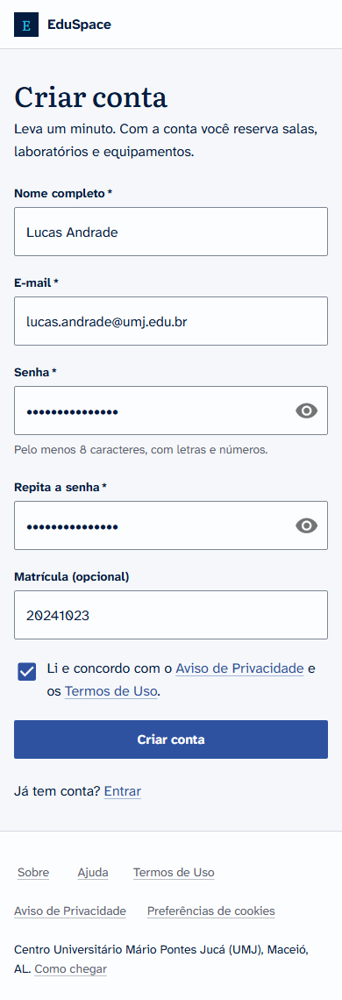

Professores e administradores recebem a conta da administração do campus. No primeiro acesso,
o sistema mostra a tela **Antes de continuar**: leia os documentos e toque em
**Li e concordo, continuar**.

### 2. Entrar

Toque em **Entrar**, informe e-mail e senha. Depois do login você vê o **Início**, com a sua
próxima reserva e o botão **Nova reserva**.

### 3. Buscar um espaço

1. Toque em **Reservar** e depois em **Filtrar**.
2. Escolha os filtros que quiser: nome, bloco, tipo (sala de estudo, laboratório, auditório ou
   equipamento), número mínimo de pessoas e características, como projetor ou ar-condicionado.
3. Em **Livre em**, informe data, início e fim para ver só o que está livre nesse horário.
4. Toque em **Ver resultados**. O número de filtros ativos aparece no botão, por exemplo
   **Filtrar (3)**. Para recomeçar, toque em **Limpar filtros**.

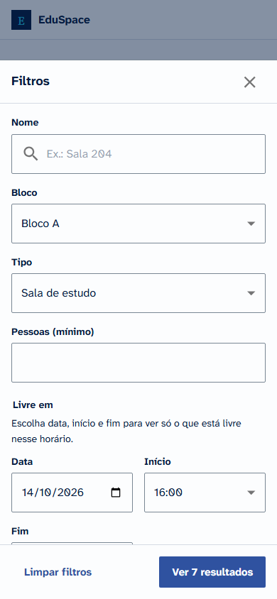

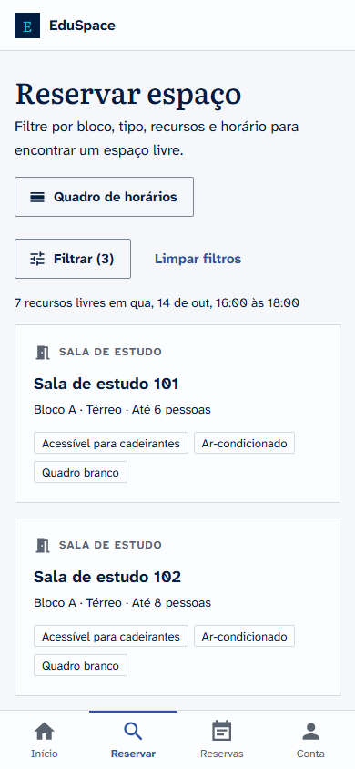

Toque no nome do espaço para abrir a grade de horários.

### 4. Escolher o horário na grade

A grade mostra o dia em blocos de 30 minutos. Use as setas ou o campo de data para trocar o dia.

1. Toque no bloco de **início**.
2. Toque no bloco de **fim**. Os blocos entre os dois ficam marcados como **Selecionado**.
3. Confira o resumo na barra de baixo e toque em **Reservar este horário**.

Se você veio da busca com data e horário, a grade já abre com esse intervalo marcado. Para
recomeçar, toque em **Limpar**. Blocos **Ocupado** já têm reserva; blocos **Encerrado** já
passaram.

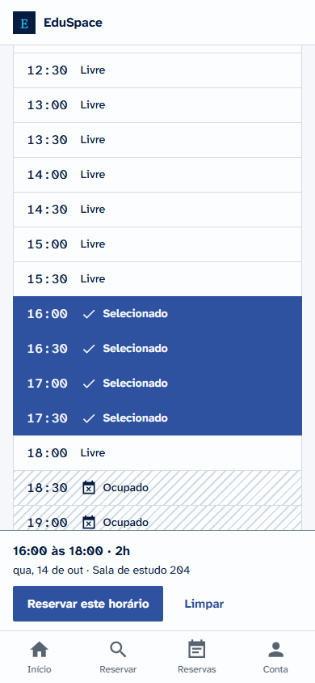

A grade se atualiza sozinha. Se alguém reservar o horário antes de você, ele aparece como
ocupado.

### 5. Confirmar no resumo

O resumo mostra espaço, local, data, horário, duração, capacidade e características. Se
quiser, informe a **finalidade** e o número de **participantes** (até a capacidade do espaço).
Toque em **Confirmar reserva**. Para mudar o horário, toque em **Voltar**.

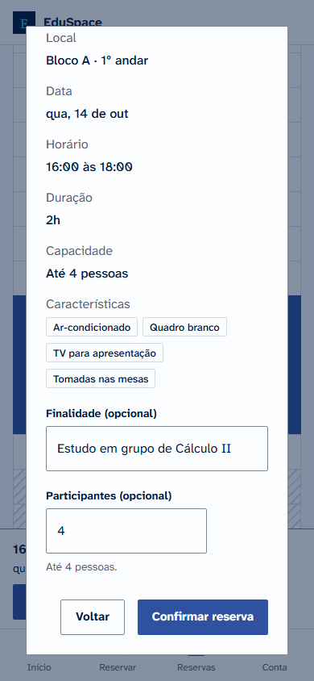

### 6. Comprovante com QR code

Depois de confirmar, você vai direto para o comprovante, com código, situação, espaço, data,
horário e QR code.

- **Imprimir ou salvar PDF**: abre a impressão do navegador. Para guardar o arquivo, escolha
  salvar como PDF.
- **Copiar link**: copia o endereço do comprovante para você enviar ou guardar.

Na entrada, mostre o comprovante no celular ou impresso. Quem confere lê o QR code e vê a
situação atual da reserva, sem precisar de login. Se a reserva for cancelada, o comprovante
passa a mostrar **Cancelada**.

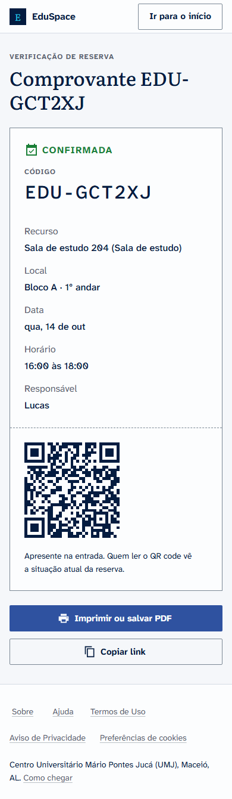

### 7. Minhas reservas

Em **Reservas** (no computador, **Minhas reservas**) há duas abas:

- **Próximas**: reservas confirmadas que ainda vão acontecer, por dia, com
  **Ver comprovante** e **Cancelar**.
- **Histórico**: reservas que já passaram e as canceladas. Quando a administração cancela uma
  reserva sua, o motivo aparece aqui.

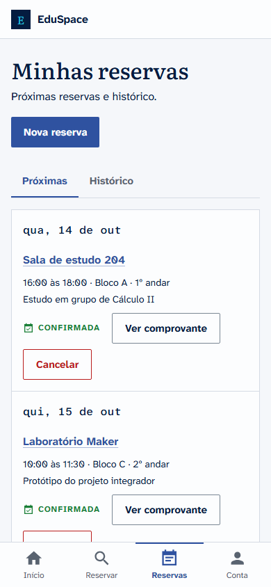

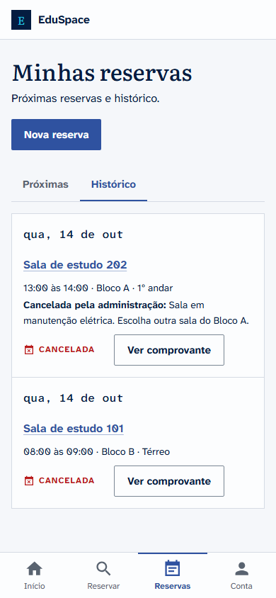

### 8. Cancelar uma reserva

1. Em **Próximas**, toque em **Cancelar** na reserva.
2. Confira os dados e toque em **Sim, cancelar**. Para desistir, toque em **Manter reserva**.

O horário fica livre para outras pessoas na hora, e o cancelamento não pode ser desfeito. Você
pode cancelar até 30 minutos antes do início. Depois disso o botão fica cinza e explica o
motivo.

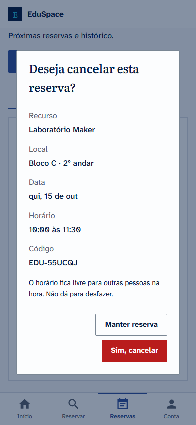

### 9. Check-in pela porta

Cada espaço tem um QR code fixado na porta. Ao chegar para a sua reserva:

1. Leia o QR da porta com a câmera do celular. Se pedir, entre na sua conta.
2. Toque em **Confirmar presença**. A tela mostra "Presença confirmada" e a hora.

O check-in abre 15 minutos antes do início e vai até 15 minutos depois. Se ninguém confirmar a
presença nesse prazo, a reserva vira **Não compareceu** e o espaço volta a ficar livre para
outras pessoas. Em Minhas reservas, cada reserva mostra a janela do check-in, a presença
confirmada ou a liberação.

Terminou antes do horário? Leia o QR da porta de novo ao sair e toque em **Encerrar uso e
liberar a sala** (ou em **Encerrar uso**, em Minhas reservas). A janela de confirmação mostra a
partir de que horas a sala fica livre: o próximo bloco de 30 minutos, nunca antes de meia hora
depois do início. O resto do horário volta para a grade na hora, e a reserva passa a mostrar
"Uso encerrado às HH:MM", também no comprovante. Encerrar não dá para desfazer.

Se você ler o QR sem ter reserva naquele espaço, a tela oferece ver os horários livres e reservar
ali mesmo.

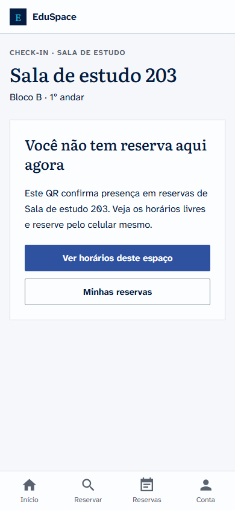

### 10. Quadro de horários

O **Quadro de horários** mostra o que já está reservado em cada espaço e equipamento num dia.
Escolha o dia, o bloco e o tipo. Os espaços aparecem agrupados por bloco: toque no nome do
bloco para abrir ou fechar a lista dele, ou em **Expandir todos os blocos**. Cada espaço mostra os
intervalos livres e ocupados, e as suas reservas aparecem marcadas como **Sua reserva**. Toque
num horário livre para abrir a grade com uma hora já marcada, ou no nome do espaço para escolher
o horário.

No celular, abra o quadro pelo botão **Quadro de horários** na tela **Reservar**.

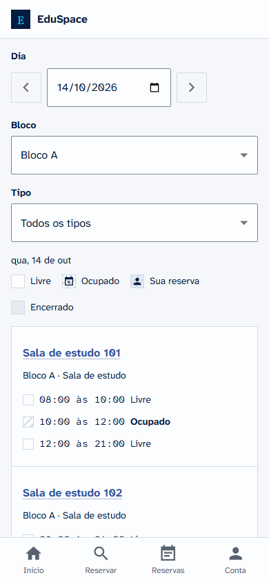

### 11. Minha conta

Em **Conta** (no computador, clique no seu nome no alto da página) você vê nome, e-mail, perfil e matrícula, e cuida dos seus dados:

- **Baixar meus dados**: baixa um arquivo com tudo o que o EduSpace guarda sobre você.
- **Excluir conta**: pede a sua senha atual. Seu nome, e-mail e matrícula são apagados, as
  reservas futuras são canceladas e você sai na hora. Não dá para desfazer. Contas de
  administrador não são excluídas por aqui.
- **Preferências de cookies**: aparece quando o campus usa medição de acesso (Google
  Analytics). Mostra a sua escolha atual e permite aceitar ou recusar a qualquer momento. O
  mesmo link fica no rodapé das páginas públicas.
- **Sair da conta**: encerra a sessão neste aparelho.

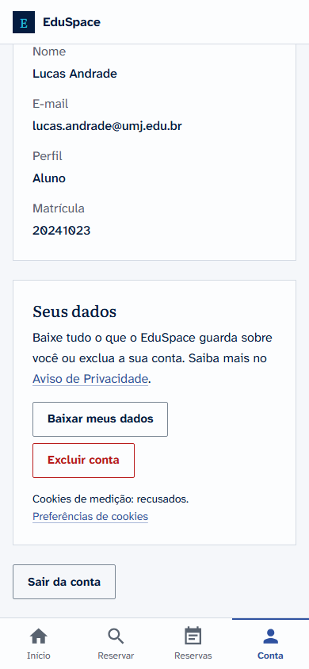

## Para a administração

As telas de administração foram pensadas para o computador. Contas com perfil
**Administrador** veem o item **Administração** no menu.

### 1. Painel de administração

O painel leva às quatro áreas: **Agenda do dia**, **Usuários**, **Recursos** e
**Blocos e características**.

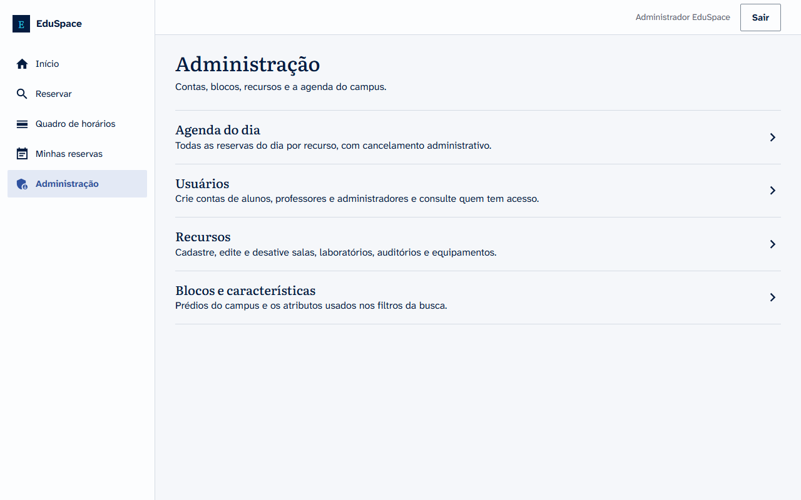

### 2. Recursos

Recursos são os espaços e equipamentos que podem ser reservados. A lista tem filtros por nome,
bloco, tipo e situação (ativos ou desativados).

- **Novo recurso**: escolha bloco e tipo, informe nome, capacidade, andar, descrição e marque as
  características. Só equipamentos podem ficar sem capacidade.
- **Editar**: muda qualquer dado do recurso.
- **Remover**: se o recurso nunca foi reservado, ele é excluído. Se já tem reservas, ele é
  desativado: some da busca, e as reservas antigas e os comprovantes continuam valendo. Se houver
  reservas futuras, o sistema avisa quantas são e pede confirmação em
  **Cancelar reservas e desativar**. Quem reservou vê a reserva cancelada no histórico.
- **Reativar**: aparece nos recursos desativados e devolve o recurso à busca.

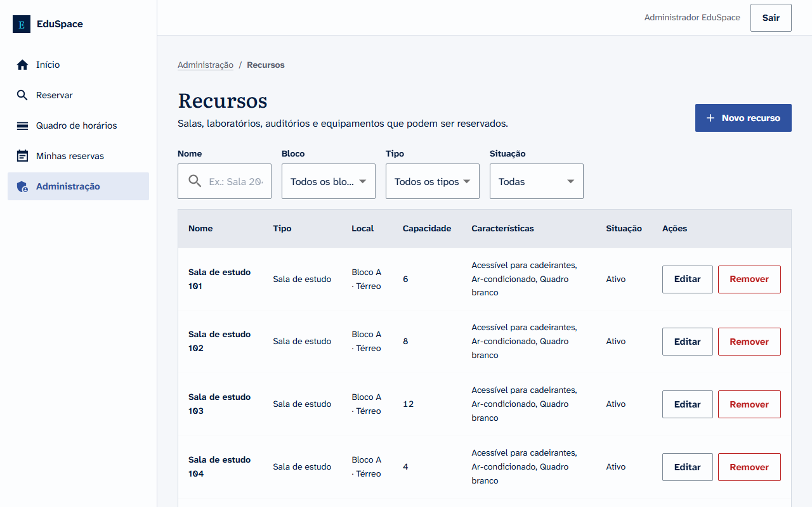

### 3. Blocos e características

A tela **Blocos e características** tem duas abas.

- **Blocos**: os prédios do campus. Use **Novo bloco**, **Editar** e **Remover**. Um bloco sem
  recursos é excluído; um bloco com recursos é desativado, e todos os recursos dele somem da
  busca. O histórico de reservas continua. **Reativar** devolve o bloco.
- **Características**: atributos que viram filtros na busca, como Projetor ou Ar-condicionado.
  Use **Nova característica**, **Renomear** e **Excluir**. Excluir tira a característica de
  todos os recursos e do filtro, sem volta.

Cadastre o bloco antes dos recursos dele.

### 4. Usuários

A tela **Usuários** lista todas as contas, com busca por nome, e-mail ou matrícula.

- **Nova conta**: crie a conta de um aluno, professor ou administrador com nome, e-mail, senha
  inicial, perfil e matrícula. Passe a senha inicial à pessoa por um canal seguro. Ela aceita o
  Aviso de Privacidade e os Termos de Uso no primeiro acesso.
- **Editar**: muda o **Perfil** (vale a partir do próximo acesso da pessoa) e a **Situação**.
  Uma conta **Desativada** não consegue entrar. O sistema pede confirmação antes de desativar.
  A sua própria conta aparece como **Sua conta** e não pode ser editada.

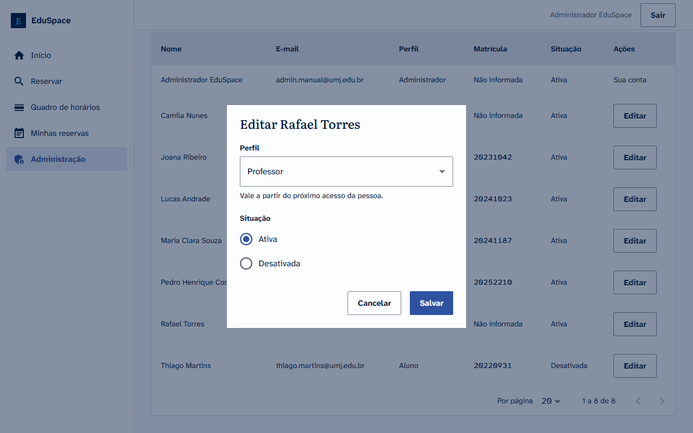

### 5. Agenda do dia

A **Agenda do dia** mostra todas as reservas de uma data, agrupadas por recurso, com nome e
e-mail de quem reservou, código e finalidade. Filtre por data, bloco e situação.

Para cancelar uma reserva:

1. Toque em **Cancelar** na reserva.
2. Escreva o **Motivo**. Ele aparece para quem reservou, então descreva a situação do espaço,
   sem dados pessoais (por exemplo, manutenção ou evento institucional).
3. Toque em **Cancelar reserva**.

A administração pode cancelar qualquer reserva que ainda não terminou, sem o prazo de 30
minutos. O horário fica livre na hora e o comprovante passa a mostrar a reserva como cancelada.

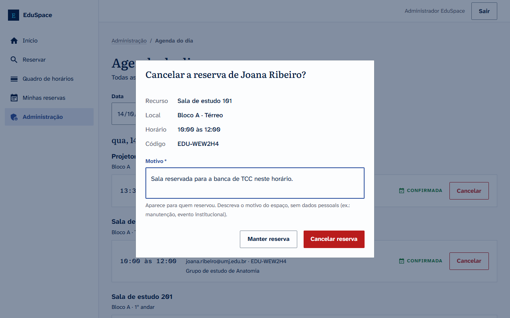

### 6. QR da porta

Em **Recursos**, o botão **QR da porta** abre o cartaz de check-in de cada espaço: nome, bloco,
o QR e a regra dos 15 minutos. Toque em **Imprimir** e fixe o cartaz na entrada.

Se o cartaz for fotografado e compartilhado, ou estragar, toque em **Gerar novo QR**. O código
impresso antes deixa de funcionar na hora; imprima e troque o cartaz.

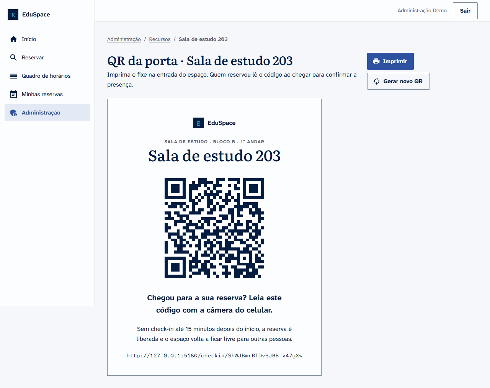

### 7. Ocupação

O painel **Ocupação** mostra como o campus usa os espaços num período (7, 30 ou 90 dias, ou
datas escolhidas), para todos os blocos ou um só:

- **Ocupação**: parte das horas disponíveis que ficou reservada.
- **Comparecimento**: reservas com check-in entre as que já começaram.
- **Horas devolvidas**: tempo que voltou a ficar livre porque ninguém fez check-in ou porque
  quem reservou encerrou o uso mais cedo.
- **Cancelamentos**: parte das reservas que foi cancelada.
- **Mapa de calor**: a ocupação de cada dia da semana e hora, com a porcentagem escrita em cada
  célula. Quanto mais escuro, mais cheio.
- **Mais usados e menos usados**, e a lista de todos os espaços.

**Baixar CSV** gera uma planilha com os números de cada espaço, que abre direto no Excel.

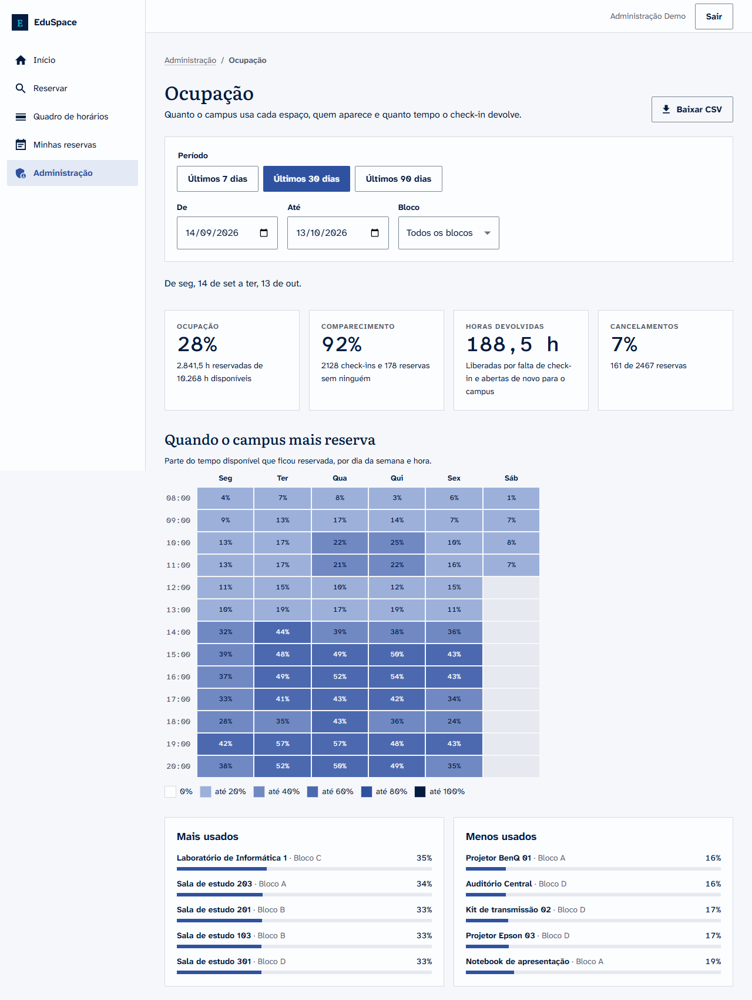

### 8. Configurações

Em **Configurações** a administração ajusta as regras que valem para todo o campus:

- **Horário de funcionamento**: para cada dia da semana, se o campus abre e o horário de abertura
  e de fechamento, de meia em meia hora.
- **Reservas**: duração máxima de uma reserva, até quantos dias à frente dá para reservar e
  quantas reservas futuras cada aluno e cada professor podem ter ao mesmo tempo.
- **Check-in pela porta**: o prazo depois do início para confirmar presença (ou **Desligado**,
  para o check-in ser opcional) e quanto antes do início a leitura do QR já é aceita.

**Salvar configurações** vale na hora para novas reservas, sem reiniciar o sistema. Reservas já
confirmadas continuam como estão. A tela mostra quem fez a última alteração e quando.

## Problemas comuns

**"Use o seu e-mail institucional para criar a conta."**
O cadastro aceita só e-mails da UMJ (`@umj.edu.br`). Use o seu e-mail institucional.

**"E-mail ou senha incorretos."**
Confira o e-mail e a senha. A recuperação de senha por e-mail ainda não está disponível:
procure a administração do campus para redefinir o acesso.

**"Esta conta está desativada."**
A administração desativou a sua conta. Procure a secretaria do seu bloco.

**"Este horário acabou de ser reservado por outra pessoa."**
Alguém confirmou antes de você. Escolha outro horário na grade ou outro espaço.

**"Você já tem 3 reservas ativas, o limite do seu perfil."**
Cancele uma reserva futura ou espere uma delas acontecer. O limite é 3 para alunos e 10 para
professores.

**"Cada reserva pode ter no máximo 4h."** ou **"Reservas podem ser feitas com até 14 dias de antecedência."**
Escolha um intervalo menor ou uma data mais próxima.

**"O campus está fechado em parte desse horário."** ou **"O campus não abre neste dia."**
Escolha um horário dentro do funcionamento: segunda a sexta, 08:00 às 21:00, e sábado, 08:00
às 12:00.

**O botão Cancelar está cinza.**
Faltam menos de 30 minutos para o início. Se precisar mesmo cancelar, procure a administração
do campus.

**"O número de participantes passa da capacidade deste espaço."**
Informe menos participantes ou escolha um espaço maior. Use o filtro **Pessoas (mínimo)** na
busca.

**A reserva aparece como cancelada no histórico e eu não cancelei.**
A administração cancelou a reserva. O motivo aparece logo abaixo do horário, em
**Minhas reservas**, aba **Histórico**.

**Não encontro um espaço que conheço.**
Ele pode estar desativado para manutenção ou fora dos filtros. Toque em **Limpar filtros** e
busque pelo nome.
