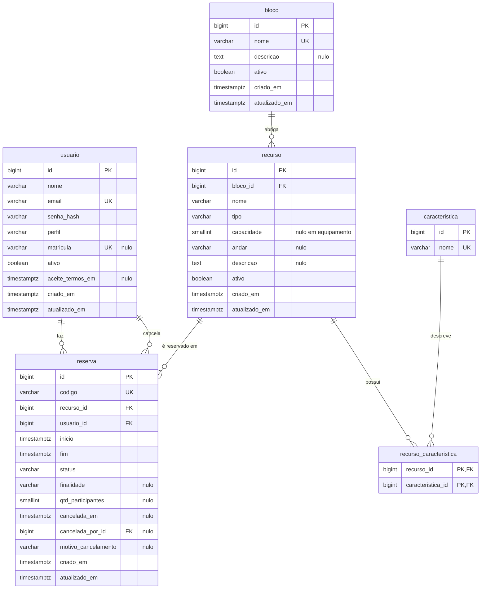

# Modelo de dados do EduSpace

Modelo relacional do MVP (PostgreSQL 16). Segue as convenções do
[ADR 0001](../adr/0001-arquitetura-e-stack.md): tabelas e colunas em português `snake_case`,
classes ORM em inglês. Issue: #13.

## Diagrama



## Mapeamento para o código

| Tabela | Model (`app/models/`) | Repositório | Observação |
|---|---|---|---|
| `usuario` | `User` | `UserRepository` | |
| `bloco` | `Building` | `BuildingRepository` | |
| `recurso` | `Resource` | `ResourceRepository` | |
| `caracteristica` | `Feature` | `FeatureRepository` | |
| `recurso_caracteristica` | tabela de associação (`resource_feature`) | | Sem classe própria; relação N:N em `Resource.caracteristicas` |
| `reserva` | `Reservation` | `ReservationRepository` | |

Enums em `app/core/enums.py`: `UserRole`, `ResourceType`, `ReservationStatus`.
Colunas `criado_em` e `atualizado_em` vêm do `TimestampMixin`.

## Dicionário de dados

Convenções de todas as tabelas:

- `id`: `BIGINT GENERATED ALWAYS AS IDENTITY`, chave primária.
- `criado_em`: `TIMESTAMPTZ NOT NULL DEFAULT now()`.
- `atualizado_em`: `TIMESTAMPTZ NOT NULL DEFAULT now()`, atualizado pelo ORM a cada alteração.
- Todo horário é gravado em UTC; a aplicação converte de e para `America/Maceio`.

### `usuario`

Pessoa que usa o sistema: aluno, professor ou administrador.

| Coluna | Tipo | Nulo | Regra |
|---|---|---|---|
| `nome` | `VARCHAR(120)` | não | Nome completo, sem espaços nas pontas |
| `email` | `VARCHAR(254)` | não | Único. Gravado em minúsculas (`CHECK (email = lower(email))`). Domínio validado contra `ALLOWED_EMAIL_DOMAINS` quando configurado (por padrão, qualquer domínio) |
| `senha_hash` | `VARCHAR(255)` | não | Hash argon2. A senha em texto nunca é gravada |
| `perfil` | `VARCHAR(20)` | não | `ALUNO`, `PROFESSOR` ou `ADMIN` (`CHECK`). Padrão `ALUNO` |
| `matricula` | `VARCHAR(20)` | sim | Única quando informada |
| `ativo` | `BOOLEAN` | não | Padrão `true`. Usuário inativo não faz login |
| `aceite_termos_em` | `TIMESTAMPTZ` | sim | Momento do aceite dos Termos de Uso e da Política de Privacidade. Obrigatório no cadastro a partir da #34; nulo só em contas criadas antes disso ou pela CLI |

### `bloco`

Prédio ou ala do campus.

| Coluna | Tipo | Nulo | Regra |
|---|---|---|---|
| `nome` | `VARCHAR(60)` | não | Único (ex.: "Bloco A") |
| `descricao` | `TEXT` | sim | Referência de localização |
| `ativo` | `BOOLEAN` | não | Padrão `true` |

### `recurso`

Tudo o que pode ser reservado: sala de estudo, laboratório, auditório ou equipamento.

| Coluna | Tipo | Nulo | Regra |
|---|---|---|---|
| `bloco_id` | `BIGINT` | não | FK `bloco(id)` `ON DELETE RESTRICT`. Para equipamento, é o local de retirada |
| `nome` | `VARCHAR(80)` | não | Único dentro do bloco: `UNIQUE (bloco_id, nome)` |
| `tipo` | `VARCHAR(20)` | não | `SALA_ESTUDO`, `LABORATORIO`, `AUDITORIO` ou `EQUIPAMENTO` (`CHECK`) |
| `capacidade` | `SMALLINT` | sim | Número de pessoas. `CHECK (capacidade > 0)`. Obrigatória para espaços: `CHECK (tipo = 'EQUIPAMENTO' OR capacidade IS NOT NULL)` |
| `andar` | `VARCHAR(20)` | sim | Ex.: "Térreo", "2º andar" |
| `descricao` | `TEXT` | sim | |
| `ativo` | `BOOLEAN` | não | Padrão `true`. Recurso inativo some da busca, mas mantém o histórico |

### `caracteristica`

Atributo pesquisável de um recurso.

| Coluna | Tipo | Nulo | Regra |
|---|---|---|---|
| `nome` | `VARCHAR(60)` | não | Único (ex.: "Projetor", "Ar-condicionado", "Computadores", "Quadro branco", "Kit de transmissão") |

### `recurso_caracteristica`

Associação N:N entre recurso e característica.

| Coluna | Tipo | Nulo | Regra |
|---|---|---|---|
| `recurso_id` | `BIGINT` | não | FK `recurso(id)` `ON DELETE CASCADE` |
| `caracteristica_id` | `BIGINT` | não | FK `caracteristica(id)` `ON DELETE RESTRICT` |

Chave primária composta `(recurso_id, caracteristica_id)`.

### `reserva`

Ocupação de um recurso por um usuário num intervalo de tempo.

| Coluna | Tipo | Nulo | Regra |
|---|---|---|---|
| `codigo` | `VARCHAR(10)` | não | Único. Formato `EDU-XXXXXX` com alfabeto sem caracteres ambíguos (sem `0`, `O`, `1`, `I`, `L`). Usado no comprovante e no QR code |
| `recurso_id` | `BIGINT` | não | FK `recurso(id)` `ON DELETE RESTRICT` |
| `usuario_id` | `BIGINT` | não | FK `usuario(id)` `ON DELETE RESTRICT` |
| `inicio` | `TIMESTAMPTZ` | não | Múltiplo de 30 minutos, no futuro, dentro do horário de funcionamento (validado no service) |
| `fim` | `TIMESTAMPTZ` | não | `CHECK (fim > inicio)` |
| `status` | `VARCHAR(20)` | não | `CONFIRMADA` ou `CANCELADA` (`CHECK`). Padrão `CONFIRMADA` |
| `finalidade` | `VARCHAR(200)` | sim | Ex.: "Reunião do Projeto Integrador" |
| `qtd_participantes` | `SMALLINT` | sim | `CHECK (qtd_participantes > 0)`. Não pode passar da capacidade do recurso (service) |
| `cancelada_em` | `TIMESTAMPTZ` | sim | Preenchido ao cancelar |
| `cancelada_por_id` | `BIGINT` | sim | FK `usuario(id)`. Dono da reserva ou admin |
| `motivo_cancelamento` | `VARCHAR(300)` | sim | Obrigatório quando um admin cancela (#30) |

Restrições da tabela:

```sql
CHECK (fim > inicio)

-- status e dados de cancelamento sempre coerentes
CHECK ((status = 'CANCELADA') = (cancelada_em IS NOT NULL))

-- RNF03: nenhum par de reservas confirmadas se sobrepõe no mesmo recurso
EXCLUDE USING gist (recurso_id WITH =, tstzrange(inicio, fim, '[)') WITH &&)
    WHERE (status = 'CONFIRMADA')
```

O intervalo `[)` inclui o início e exclui o fim, então 19:00–20:00 e 20:00–21:00 podem coexistir.
Requer a extensão `btree_gist`, habilitada na primeira migração (#10).

## Índices

| Índice | Atende |
|---|---|
| GiST da exclusion constraint `(recurso_id, tstzrange(inicio, fim))` | Verificação de sobreposição, disponibilidade do dia e busca por horário livre |
| `reserva (usuario_id, inicio DESC)` | Minhas reservas, próximas e histórico |
| `reserva (inicio)` | Agenda do dia do admin |
| `recurso (bloco_id)` e `recurso (tipo)` | Filtros da busca |
| `recurso_caracteristica (caracteristica_id)` | Filtro por característica |
| Únicos de `usuario.email`, `usuario.matricula`, `bloco.nome`, `recurso (bloco_id, nome)`, `caracteristica.nome`, `reserva.codigo` | Integridade e consultas por chave natural |

## Decisões

| Decisão | Motivo |
|---|---|
| Enums como `VARCHAR` + `CHECK`, sem `ENUM` nativo do PostgreSQL | Alterar um `ENUM` nativo em migração é trabalhoso; `CHECK` muda com um `ALTER TABLE` simples. No código continuam tipados como `StrEnum` |
| Equipamento é um `recurso` com tipo `EQUIPAMENTO` | A regra de reserva e a constraint de sobreposição são as mesmas para espaços e equipamentos |
| Nada com histórico é apagado: usuário, bloco e recurso são desativados (`ativo = false`); reserva é cancelada. Só bloco sem recursos e recurso nunca reservado são excluídos de vez (ADR 0002) | Preserva histórico, comprovantes e auditoria |
| Status "concluída" não é gravado | É derivado: `status = 'CONFIRMADA' AND fim < now()`. Evita job agendado e estado inconsistente |
| Código do comprovante separado do `id` | Não expõe a sequência interna e é fácil de ditar ou digitar na entrada da sala |
| Chaves `BIGINT IDENTITY` em vez de UUID | Mais simples de ler, indexar e depurar no escopo do MVP; o que é público usa o `codigo` |
| Regras de horário (múltiplo de 30 min, funcionamento, duração máxima) no service, não no banco | Dependem de configuração e de fuso horário; o banco garante só o que nunca muda (sobreposição, coerência) |

## Dados pessoais (LGPD)

| Dado | Onde | Finalidade | Exposição |
|---|---|---|---|
| Nome | `usuario.nome` | Identificar quem reservou | Comprovante público mostra só o primeiro nome; grade de disponibilidade não mostra nada para usuário comum |
| E-mail institucional | `usuario.email` | Login e comunicação | Nunca em página pública nem em log completo |
| Matrícula | `usuario.matricula` | Identificação acadêmica opcional | Só para o próprio usuário e admin |
| Hábitos de uso | `reserva` | Gestão dos espaços | Só para o dono e admin; relatórios agregados |
| Credencial | `usuario.senha_hash` | Autenticação | Nunca sai da API |

Retenção e eliminação (direito do titular, Art. 18) ficam definidas na Política de Privacidade
(#34). A auditoria LGPD completa acontece na implementação do cadastro (#15).

## Como validar este modelo

| Requisito | Coberto por |
|---|---|
| RF01, cadastro e login institucional | `usuario.email` único e minúsculo, `perfil`, `ativo` |
| RF02, busca por data, horário e recursos | `recurso`, `bloco`, `caracteristica`, índice GiST |
| RF03, reserva em tempo real | `reserva` com `status = CONFIRMADA` |
| RF04, cancelamento com 30 min | `cancelada_em`, `cancelada_por_id`, regra no service |
| RNF03, sem sobreposição | Exclusion constraint |
| História 02, resumo e bloqueio de horário ocupado | Exclusion constraint + consulta de disponibilidade |
| História 03, horário volta a ficar disponível | Reserva cancelada sai da constraint (`WHERE status = 'CONFIRMADA'`) |
| Jornada passo 5, comprovante | `reserva.codigo` |
