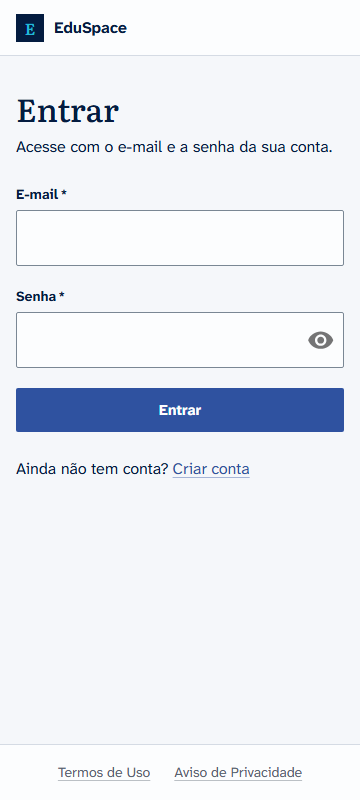
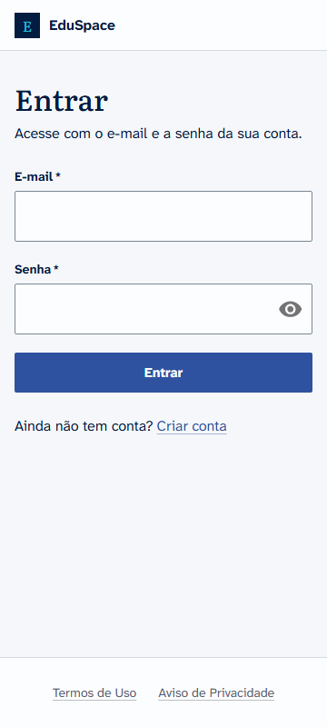
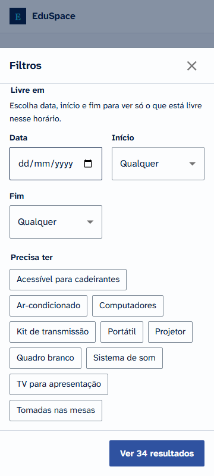
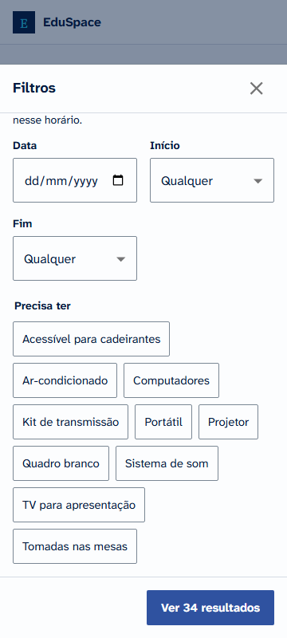
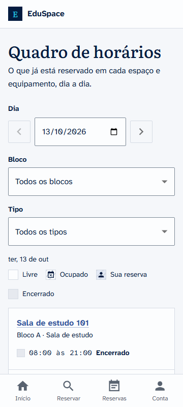
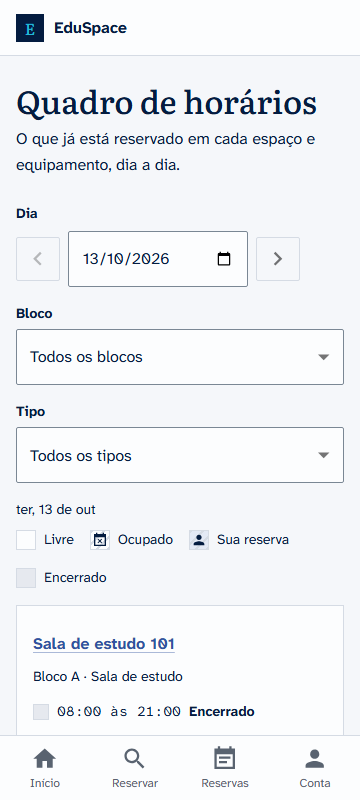

# Responsividade e acessibilidade: RNF01

- **Issue:** #32
- **Data da medição local:** 13/10/2026
- **Resultado:** as 23 telas e estados auditados passam em 360, 390, 768 e 1366 px sem rolagem
  horizontal, com alvos de toque de 44 px no celular e **zero violações** WCAG 2.2 AA no axe-core.
  O fluxo principal roda inteiro só com teclado. Lighthouse mobile: **Acessibilidade 100** nas
  três telas medidas; Performance 81 no login, 72 na busca e 68 na grade (meta: 80, ver abaixo).

## Como é verificado

Tudo roda com `npm run e2e` (Playwright, banco `eduspace_e2e` recriado a cada execução) e no
workflow `E2E` do GitHub a cada push na `main`. Nada depende de conferência manual.

| Teste | O que garante |
|---|---|
| [`e2e/accessibility.e2e.ts`](../../frontend/e2e/accessibility.e2e.ts) | 23 telas e estados (públicas, aluno, admin, diálogos, drawer de filtros, erros de formulário) em **360x800, 390x844, 768x1024 e 1366x768**: nenhuma rolagem horizontal; abaixo de 900 px, todo controle e link solto com 44 px ou mais; em 360 e 1366 px, axe-core com as regras `wcag2a`, `wcag2aa`, `wcag21a`, `wcag21aa` e `wcag22aa` |
| [`e2e/keyboard.e2e.ts`](../../frontend/e2e/keyboard.e2e.ts) | Entrar, escolher horário na grade, abrir o resumo, fechar com Esc (o foco volta ao botão), confirmar, ver o comprovante e cancelar, só com Tab, Enter e Espaço. Em cada parada confere que o foco está visível |
| [`e2e/mobile.e2e.ts`](../../frontend/e2e/mobile.e2e.ts) | Fluxo completo num Pixel 7 sem rolagem horizontal em nenhuma etapa |

Links dentro de texto corrido ficam fora da regra de 44 px, como prevê a WCAG 2.5.8.

## O que foi corrigido

A primeira rodada da auditoria apontou só alvos de toque pequenos; contraste, rótulos e
estrutura já passavam no axe.

| Problema (celular) | Antes | Correção |
|---|---|---|
| Marca "EduSpace" no topo | 28 px de altura | Padrão `touchTarget` (44 px) em `theme/patterns.ts` |
| Links do rodapé (Termos, Privacidade) | 23 px | `touchTarget` |
| "Pular para o conteúdo" | 42 px | `touchTarget` |
| Botões só com ícone ("Mostrar senha", "Fechar filtros") | 43 px | `MuiIconButton` com mínimo de 44 px no tema |
| Chips de filtro ("Precisa ter") na busca e no cadastro de recurso | 36 px | `MuiChip` clicável com 44 px abaixo de 900 px (36 px no desktop) |
| Nomes de recurso no quadro e em Minhas reservas, breadcrumbs | 18 a 21 px | `touchTarget` |
| "Linhas por página" nas tabelas da administração | 32 px | `MuiTablePagination` com 44 px |

O Lighthouse também mostrou um deslocamento de layout (CLS 0,112) na busca do celular, invisível
nos testes de unidade:

- `useMediaQuery` do MUI começa falso no primeiro render; o celular desenhava o painel de
  filtros do desktop e trocava pelo botão "Filtrar" em seguida. Em SPA sem SSR o certo é
  `noSsr`, aplicado no tema.
- Os esqueletos da lista usavam o índice como chave, e o React reaproveitava o `<li>` do
  esqueleto 1 para o recurso de id 1, que o navegador contava como o mesmo elemento pulando de
  lugar. Esqueletos agora têm chave própria.

## Lighthouse (mobile)

Medido com [`frontend/scripts/lighthouse.mjs`](../../frontend/scripts/lighthouse.mjs): Lighthouse
13.5 no perfil mobile padrão (4G lento simulado, CPU 4x mais lenta), build de produção servido
pelo `vite preview` e API local com o seed. O cache HTTP é limpo antes de cada tela, então toda
medição é de primeira visita; a sessão fica no `localStorage`. Mediana de 3 rodadas por tela, no
mesmo computador, antes e depois das mudanças desta issue.

| Tela | Performance antes | Performance depois | Acessibilidade | Boas práticas | LCP depois | TBT depois | CLS antes / depois |
|---|---|---|---|---|---|---|---|
| Login | 76 | **81** | 100 | 100 | 3,6 s | 250 ms | 0 / 0 |
| Busca (`/reservar`) | 65 | **72** | 100 | 100 | 4,3 s | 390 ms | 0,112 / **0** |
| Grade (`/recursos/:id`) | 61 | **68** | 100 | 100 | 4,2 s | 550 ms | 0,001 / 0 |

SEO ficou em 91 nas três porque ainda não há `robots.txt`; isso é da #48.

Para repetir (API em `:8100` com o banco do E2E e o build em `:4173`):

```bash
cd frontend
VITE_API_URL=http://127.0.0.1:8100/api/v1 npm run build
npx vite preview --port 4173
node scripts/lighthouse.mjs
```

### O que melhorou a performance

| Mudança | Efeito |
|---|---|
| `fetch` nativo no `HttpClient` no lugar do axios | 13 KB a menos em toda tela |
| Remoção do `@mui/x-date-pickers` (o `LocalizationProvider` estava na raiz sem nenhum DatePicker) e do peso 600 da Literata (usado só no "E" da marca) | Menos JS e uma fonte a menos no primeiro carregamento |
| Diálogo de reserva carregado sob demanda (o chunk começa a baixar quando o primeiro horário é escolhido) | Zod e react-hook-form (38 KB) saem do carregamento da grade |
| Chunk da página da URL aberta baixado junto com o bundle principal | Antes, só saía depois de `/auth/me` responder |
| Grade buscada junto com os dados do recurso | Antes, esperava o cabeçalho da página |
| Preload das três fontes do primeiro render | Fontes chegam antes do texto, sem troca visível |
| Rótulos de característica como `span` estilizado, no lugar do `Chip` do MUI | TBT da busca de 580 para 440 ms (são até ~100 rótulos por página) |

### Por que busca e grade ainda ficam abaixo de 80

As telas privadas fazem três idas e voltas em série antes do conteúdo principal: o JavaScript, a
sessão (`/auth/me`) e os dados da página. No perfil simulado do Lighthouse cada ida e volta custa
caro, e o maior elemento da tela (o texto da página) só aparece depois da sessão. Medições
feitas durante esta issue:

- **API na mesma origem do front** (proxy `/api`, como um rewrite da Vercel faria) elimina o
  preflight de CORS em cada chamada e rendeu **+4 a +7 pontos** na busca e na grade (73 e 71). Fica
  como recomendação para o deploy da #19.
- Mostrar a página antes de `/auth/me` responder tiraria uma ida e volta inteira, mas a tela de
  aceite dos termos (LGPD, #34) precisa vir antes de qualquer tela, e o menu de administração
  mudaria depois do primeiro desenho. Não vale o risco.
- O critério da issue pede a medição **em produção**, que depende do deploy (#19). Lá entram
  HTTP/2, brotli e CDN, que a medição local não tem.

## Prints antes e depois (360 px)

| Tela | Antes | Depois |
|---|---|---|
| Entrar (marca e rodapé) |  |  |
| Filtros no celular (chips) |  |  |
| Quadro de horários (links dos recursos) |  |  |
